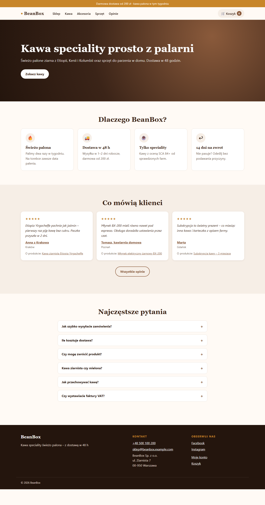
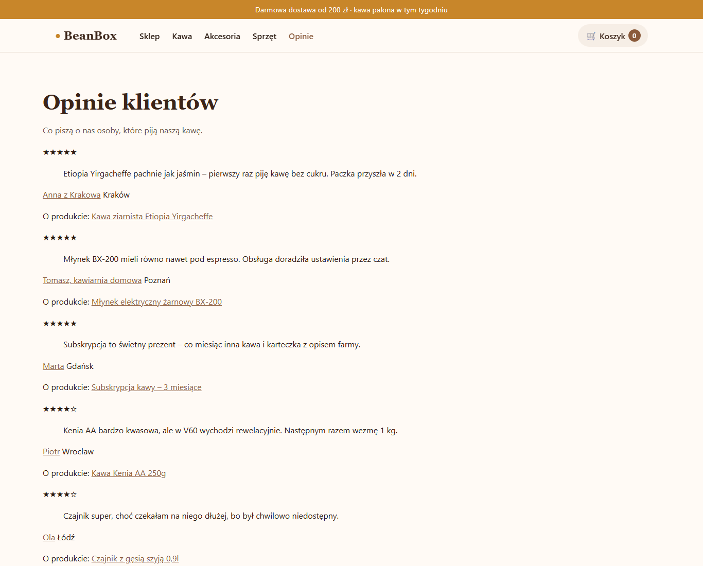
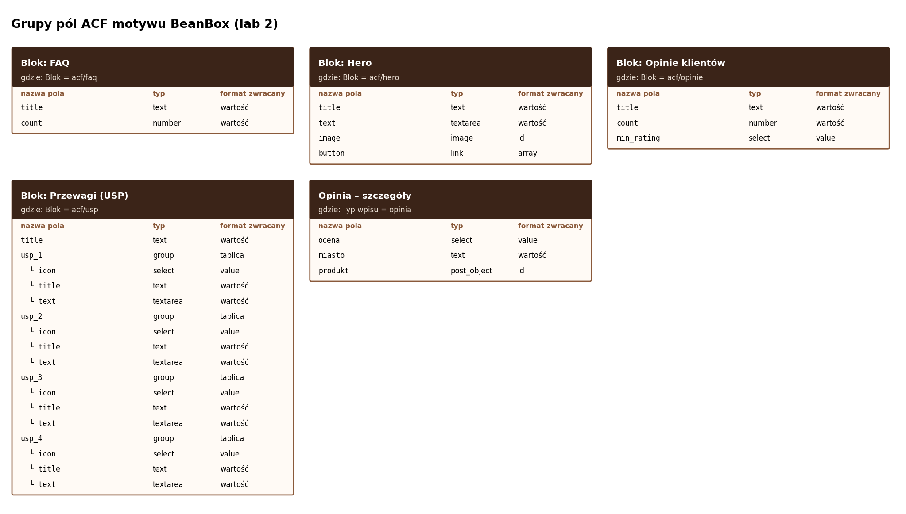
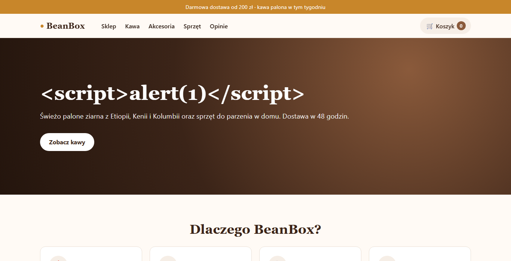

# Sprawozdanie 2 – ACF, własne typy treści i bloki

**Zespół:** _imię nazwisko_, _imię nazwisko_
**Projekt:** autorski motyw WordPress sklepu internetowego **BeanBox** (kawa speciality i akcesoria)
**Repozytorium:** https://github.com/Mateuszl28/beanbox (tag `lab2`)
**Środowisko:** Local (WordPress 7.1, PHP 8.2, nginx, MySQL), Secure Custom Fields 6.9 (SCF), WooCommerce 11.2

---

## 1. Cel i wynik

Po tych zajęciach strona główna sklepu składa się wyłącznie z naszych bloków, a klient edytuje treść przez pola formularza – bez HTML i bez page buildera. Programista decyduje o wyglądzie (szablon PHP + CSS), klient o treści (tytuł, opis, zdjęcie, przycisk).



## 2. Realizacja zadań

| Zadanie | Realizacja | Gdzie w kodzie |
|---|---|---|
| Katalog `acf-json`, pola w repozytorium | 7 grup pól jako pliki JSON (5 z laboratorium 2); ACF/SCF zapisuje je przy każdej zmianie grupy w panelu | `beanbox/acf-json/` |
| Min. 4 własne bloki ACF, strona główna tylko z nich | **Hero**, **Przewagi (USP)**, **Opinie klientów** (z CPT), **FAQ** (z CPT + JSON-LD FAQPage); każdy blok to katalog z `block.json`, `render.php`, `style.css`, rejestrowany automatycznie pętlą po `blocks/*/block.json` | `beanbox/blocks/`, `inc/blocks.php`, `front-page.php` |
| Min. 1 CPT z polami ACF, archiwum i widok pojedynczy | CPT **opinia** (`/opinie/`, pola: ocena 1–5, miasto, produkt) z szablonami `archive-opinia.php` i `single-opinia.php`; dodatkowo CPT **faq** jako źródło bloku FAQ | `inc/post-types.php`, `archive-opinia.php`, `single-opinia.php` |
| Lista dostępnych bloków ograniczona filtrem | `allowed_block_types_all`: 4 nasze bloki + akapit, nagłówek, lista, obrazek, shortcode; strony koszyka/zamówienia/konta WooCommerce zachowują swoje bloki | `inc/blocks.php` |
| Dane globalne edytowalne z panelu, w stopce | Customizer → *Dane sklepu*: telefon, e-mail, adres, Facebook, Instagram, pasek promocji; każde pole ma funkcję `sanitize_*` przy zapisie | `inc/customizer.php`, `footer.php`, `header.php` |
| Każda wartość escapowana, brak `the_field()` | `get_field()` + `esc_html()` / `esc_attr()` / `esc_url()` / `wp_kses_post()` / `wp_get_attachment_image()`; `grep -r the_field` → 0 wyników | wszystkie szablony |
| Commit i tag `lab2` | commit „Lab 2: ACF, własne typy treści i bloki”, tag `lab2` | GitHub |



**Wtyczka pól.** Bloki ACF (`acf_register_block_type`, sekcja `"acf"` w `block.json`) są w zwykłym Advanced Custom Fields funkcją wersji PRO – w wersji darmowej bloki rejestrowały się, ale renderowały pusty HTML (`acf_get_block_type()` nie istniało). Użyliśmy **Secure Custom Fields** – darmowego forka ACF z repozytorium WordPress.org, który zawiera bloki i ma identyczne API (`get_field()`, `acf-json`). Mimo to motyw nie korzysta z Repeatera ani strony opcji (funkcji PRO w ACF), żeby działał w obu wtyczkach: przewagi to 4 grupy pól, FAQ to osobny typ treści, dane globalne są w Customizerze.

## 3. Pytania do sprawozdania

### 3.1. Schemat grup pól



Obrazki mają format zwracany **ID** – wtedy `wp_get_attachment_image()` sam generuje `srcset`, `sizes`, `alt` i `loading="lazy"`. Pole *link* zwraca **tablicę** (`url`, `title`, `target`), a pole *post_object* w opinii zwraca **ID produktu**, z którego szablon buduje link i tytuł. Schemat jest generowany skryptem `narzedzia/schemat_pol.py` bezpośrednio z plików `acf-json`, więc zawsze odpowiada temu, co jest w repozytorium.

### 3.2. ACF a page builder

| Perspektywa | ACF + bloki z szablonem PHP | Page builder (np. Elementor, Divi) |
|---|---|---|
| **Klient** | 1. Prosty formularz: wpisuje tytuł, opis, wybiera zdjęcie – nie może „zepsuć” układu. | Pełna swoboda: kolor, odstęp, czcionka w każdym miejscu. |
| | 2. Spójny wygląd po latach – każda sekcja wygląda tak samo, bo wygląd jest w kodzie. | Po roku zwykle niespójne marginesy, kolory i rozmiary czcionek na różnych podstronach. |
| | 3. Szybsza strona (mniej HTML, CSS i JS) – lepsze SEO i konwersja. | Ciężki HTML i dużo skryptów – wolniejsze ładowanie, zwłaszcza na telefonie. |
| | 4. Mniej możliwości: nową sekcję musi dodać programista. | Nową sekcję klient złoży sam, bez programisty. |
| **Programista** | 1. Kod w repozytorium: szablony PHP, CSS i definicje pól (`acf-json`) mają historię zmian w git i przechodzą review. | Układ i style żyją w bazie danych jako zserializowane dane – trudne do wersjonowania i porównywania. |
| | 2. Treść oddzielona od prezentacji – można przebudować wygląd bez ruszania treści. | Treść jest pomieszana z ustawieniami wyglądu; zmiana szaty graficznej wymaga przeklikania każdej strony. |
| | 3. Pełna kontrola nad HTML: semantyka, dostępność, escapowanie każdej wartości. | Wygenerowany HTML jest poza kontrolą, często zagnieżdżony w wielu `div`. |
| | 4. Więcej pracy na start: każdy blok trzeba zaprojektować i zakodować. | Szybki start – gotowe widżety, bez kodu. |
| | 5. Brak uzależnienia od dostawcy – motyw działa po wyłączeniu wtyczki budującej strony. | Uzależnienie: po wyłączeniu buildera strony rozsypują się w shortcody. |

### 3.3. Test `<script>alert(1)</script>` w tytule bloku Hero

Wpisaliśmy w pole *Tytuł* bloku Hero tekst `<script>alert(1)</script>` i otworzyliśmy stronę główną.

**Co się stało:** alert się **nie** pojawił, a na stronie wyświetlił się dosłowny tekst `<script>alert(1)</script>`. W kodzie HTML strony jest:

```
<h1 class="hero__title">&lt;script&gt;alert(1)&lt;/script&gt;</h1>
```



**Dlaczego:** szablon wyświetla tytuł przez `echo esc_html( $title )`. Funkcja `esc_html()` zamienia znaki specjalne HTML na encje (`<` → `&lt;`, `>` → `&gt;`, `"` → `&quot;`, `&` → `&amp;`). Przeglądarka dostaje więc tekst, a nie znacznik, i nie uruchamia skryptu.

**Bez `esc_html()`:** wartość trafiłaby do HTML bez zmian, przeglądarka utworzyłaby element `<script>` i wykonała `alert(1)` u każdego odwiedzającego. To atak **stored XSS** (trwały): zamiast `alert` atakujący mógłby wstawić skrypt kradnący ciasteczka sesji administratora, przekierowujący na fałszywą stronę płatności albo podmieniający numer konta w zamówieniu. W WordPressie domyślnie tylko administrator i redaktor (uprawnienie `unfiltered_html`) mogą zapisać `<script>` w treści, ale pola ACF w blokach i dane z innych źródeł (import, API, przejęte konto redaktora) też mogą zawierać taki kod – dlatego escapujemy **zawsze, przy wyświetlaniu** („escape late”), niezależnie od tego, skąd dane pochodzą. Z tego samego powodu nie używamy `the_field()`, które wyświetla wartość bez kontroli kontekstu.

### 3.4. Po co jest Local JSON i co, gdy dwie osoby zmienią tę samą grupę pól?

**Po co:** domyślnie definicje pól ACF są w bazie danych, a każda osoba w zespole ma własną bazę (Local na swoim komputerze). Pola utworzone przez jedną osobę nie dotarłyby do pozostałych. Z katalogiem `acf-json/` w motywie ACF przy każdym zapisie grupy zapisuje też plik `group_….json`. Plik trafia do repozytorium razem z kodem, który z tych pól korzysta, więc:
- po `git pull` druga osoba widzi w *ACF → Grupy pól* komunikat „Dostępna synchronizacja” i jednym kliknięciem wczytuje pola do swojej bazy;
- definicje pól mają historię zmian i przechodzą przez review jak kod;
- ACF czyta pola z plików JSON zamiast z bazy, co przyspiesza ładowanie panelu.

**Dwie osoby zmieniają tę samą grupę:** każda zapisuje grupę u siebie, więc ACF nadpisuje ten sam plik `group_bb_….json`, w tym pole `modified` (znacznik czasu). Przy łączeniu gałęzi git zgłosi **konflikt** w pliku JSON (zawsze przynajmniej w linii `"modified"`). Trzeba go rozwiązać ręcznie – połączyć obie listy pól, zachować unikalne klucze `field_…`, ustawić nowszy `modified` – a potem każda osoba robi synchronizację. Jeśli konflikt zostanie rozwiązany „na ślepo” (wybór jednej wersji), zmiany drugiej osoby znikną z JSON, a przy kolejnym zapisie w panelu – także z bazy. Niebezpieczne jest też ponowne użycie tego samego klucza `field_…` dla innego pola – ACF potraktuje to jako jedno pole i wartości się pomieszają. Zasady w zespole: jedna osoba zmienia daną grupę naraz, `git pull` i synchronizacja przed edycją pól, małe commity z samym plikiem JSON grupy.

## 4. Problemy i rozwiązania

- **Bloki renderowały pusty HTML** z darmowym ACF (bloki to funkcja PRO) → przejście na Secure Custom Fields, bez zmian w kodzie motywu.
- **Kolor tytułu Hero** – ogólna reguła `h1 { color: … }` ustawia kolor bezpośrednio na nagłówku, więc biały kolor sekcji nie był dziedziczony i tytuł był ciemny na ciemnym tle; dodano `color: #fff` w klasie `.hero__title`.
- **Adres `/opinie/` zwracał 404** zaraz po rejestracji CPT – trzeba odświeżyć reguły przepisywania (*Ustawienia → Bezpośrednie odnośniki → Zapisz* albo `wp rewrite flush`).
- **Zapis bloku ACF w treści strony** – dane pól są w komentarzu bloku jako JSON (`"title"` + `"_title": "field_…"`); bez klucza pola (`_title`) ACF nie zawsze rozpoznaje format zwracany.

## 5. Wnioski

Podział „programista – wygląd, klient – treść” daje spójny i szybki sklep, ale wymaga przemyślenia bloków z góry. Najważniejsze zasady: pola w repozytorium (Local JSON), escapowanie każdej wartości przy wyświetlaniu i ograniczona lista bloków, dzięki której klient nie ma pod ręką 90 bloków Gutenberga.
