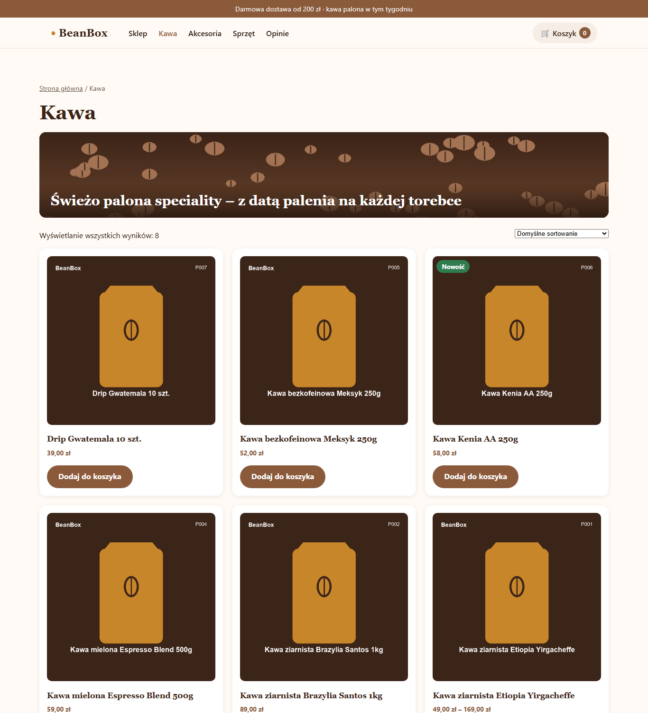
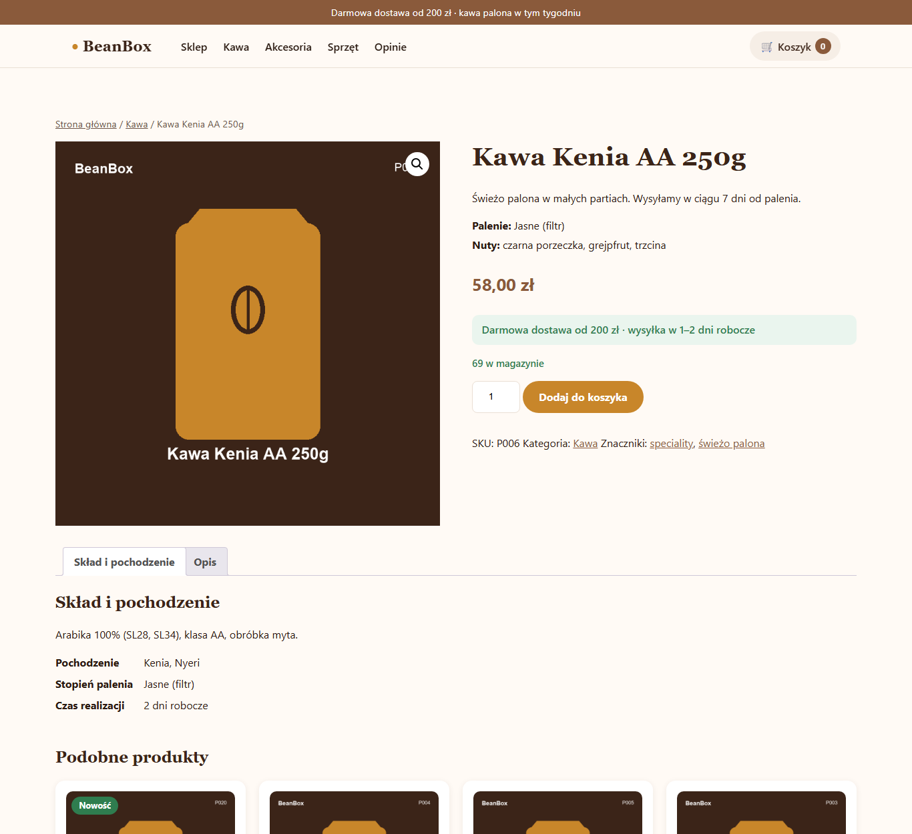
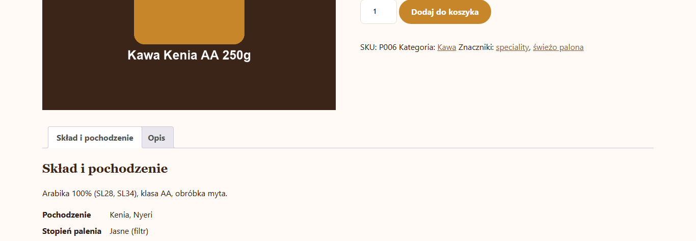
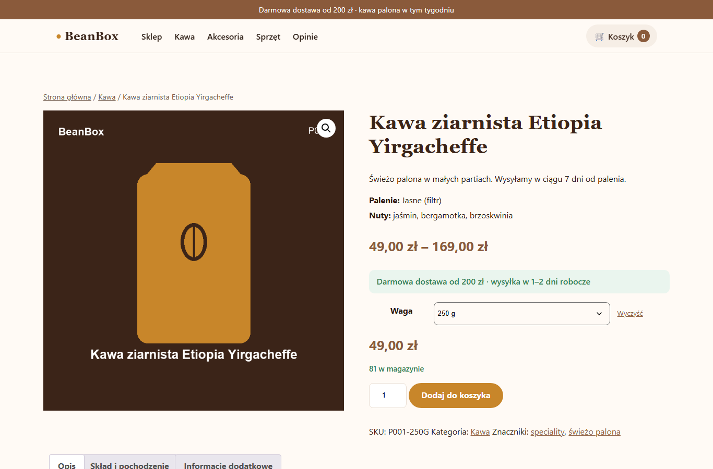
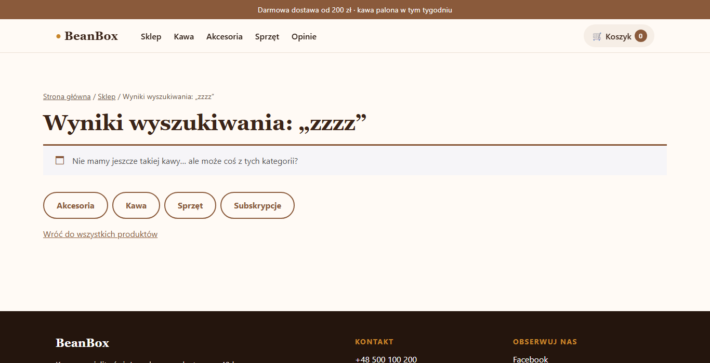
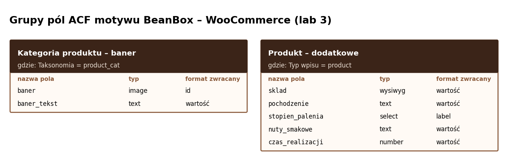
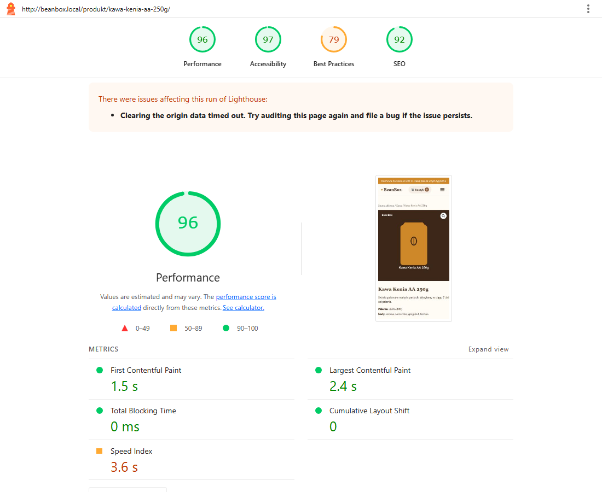
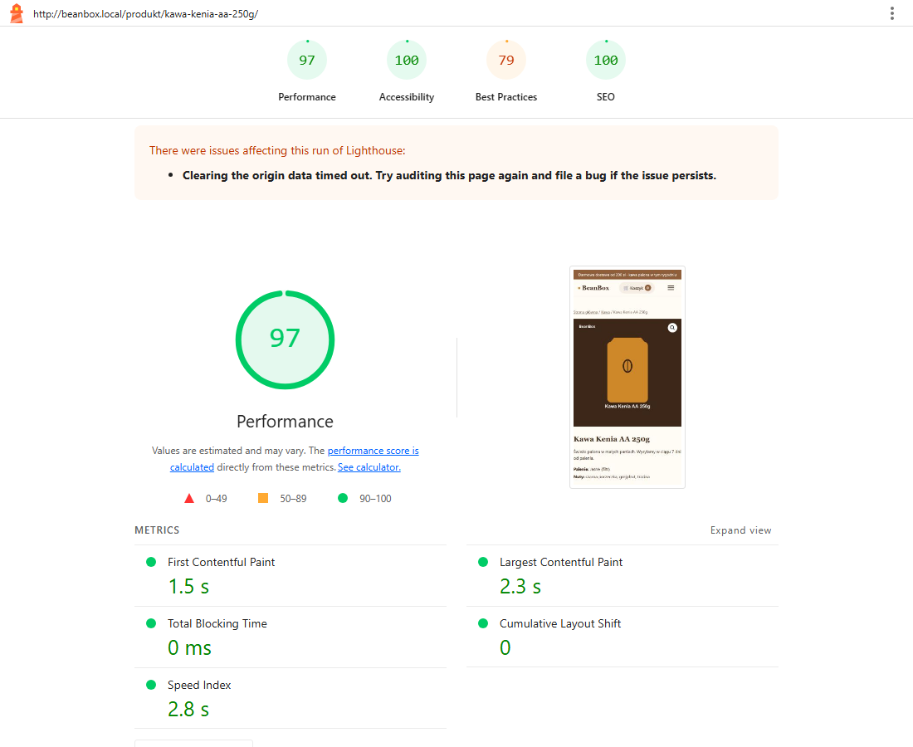

# Sprawozdanie 3 – WooCommerce w autorskim motywie

**Zespół:** _imię nazwisko_, _imię nazwisko_
**Projekt:** sklep internetowy **BeanBox** – motyw `beanbox`
**Repozytorium:** https://github.com/Mateuszl28/beanbox (tag `lab3`)
**Środowisko:** Local (WordPress 7.1, PHP 8.2), WooCommerce 11.2, Secure Custom Fields 6.9, Query Monitor 4.0

---

## 1. Cel i wynik

Klient przechodzi całą ścieżkę zakupową – lista produktów, karta produktu, koszyk, zamówienie – w wyglądzie naszego motywu, z dodatkowymi polami ACF na produktach i kategoriach.

## 2. Realizacja zadań

| Zadanie | Realizacja |
|---|---|
| WooCommerce skonfigurowany: PLN, wysyłka, 2 metody płatności | Polska, PLN (format `1 234,56 zł`), ceny brutto bez naliczania podatku; strefa wysyłki **Polska**: *Kurier* 15 zł + *Darmowa dostawa* od 200 zł; płatności: **przelew bankowy** i **płatność przy odbiorze**; AJAX-owe dodawanie do koszyka w archiwach włączone (`narzedzia/konfiguracja-woo.php`) |
| Min. 15 produktów w 3 kategoriach, 1 wariantowy, każdy z SKU | **25 produktów w 4 kategoriach** (Kawa 8, Akcesoria 12, Sprzęt 4, Subskrypcje 1), import CSV (*Produkty → Importuj*); **Kawa Etiopia Yirgacheffe** jest wariantowa: 250 g (49 zł, SKU `P001-250G`) i 1 kg (169 zł, SKU `P001-1KG`). SKU `P001…P025` są te same co w arkuszu Google projektu BeanBox – na zajęciach 4 będą kluczem synchronizacji |
| Strony sklepu w obudowie motywu, bez paska bocznego | `remove_action` domyślnego opakowania i paska bocznego, własny `
` (`inc/woocommerce.php`) |
| Karta produktu: układ przez hooki + zakładka z min. 2 polami ACF | cena przeniesiona pod krótki opis, nad przyciskiem informacja o darmowej dostawie, pod opisem stopień palenia i nuty smakowe; zakładka **„Skład i pochodzenie”** z 4 pól ACF (skład, pochodzenie, stopień palenia, czas realizacji) |
| Baner kategorii z pola ACF | grupa pól „Kategoria produktu – baner” (reguła: *Taksonomia = Kategoria produktu*): obrazek + hasło, wyświetlane hookiem `woocommerce_archive_description` |
| Znaczek „Nowość” i min. 1 nadpisany szablon widoczny w *Status → Szablony* | znaczek dla produktów młodszych niż 30 dni (4 produkty); nadpisany `loop/no-products-found.php` – *WooCommerce → Status → Szablony*: „wp-content/themes/beanbox/woocommerce/loop/no-products-found.php”, wersja 7.8.0 = wersja w WooCommerce (nieaktualnych szablonów: brak) |
| Mini-koszyk aktualizowany bez przeładowania | licznik `span.cart-count` w nagłówku + filtr `woocommerce_add_to_cart_fragments` + `wc-cart-fragments` |
| Testowe zamówienie widoczne w panelu | zamówienie **#224**: Etiopia 1 kg ×1 + filtry V60 ×2 = 219 zł, *Darmowa dostawa* (próg 200 zł), *Przelew bankowy*, status „Wstrzymane” – utworzone przez API WooCommerce (`narzedzia/zamowienie-testowe.php`), widoczne w *WooCommerce → Zamówienia* |
| Commit i tag `lab3` | commit „Lab 3: WooCommerce w autorskim motywie”, tag `lab3` |

**Deklaracja wsparcia.** W `beanbox_setup()` (`inc/setup.php`): `add_theme_support( 'woocommerce', [ 'thumbnail_image_width' => 600, 'single_image_width' => 900 ] )` oraz zoom, lightbox i slider galerii. Bez tego WooCommerce uznałby motyw za niekompatybilny.

**Style WooCommerce – decyzja zespołu:** zostawiliśmy domyślne style Woo i nadpisujemy je w `assets/css/main.css`. Dzięki temu formularze koszyka i zamówienia, komunikaty i tabele działają od razu, a my dopasowujemy kolory, przyciski, siatkę produktów (CSS Grid: 1 → 2 → 3 kolumny) i pola formularzy (min. 44 px wysokości). Wada: musieliśmy dopasować specyficzność selektorów – Woo ustawia `width: 30.75%` selektorem `ul.products[class*=columns-] li.product`, więc dopiero taki sam selektor w motywie przywrócił pełną szerokość kafelków.

## 3. Pytania do sprawozdania

### 3.1. Nadpisane szablony i użyte hooki

| Hook / szablon | Priorytet | Co robi | Dlaczego hook / dlaczego nadpisanie |
|---|---|---|---|
| `remove_action( 'woocommerce_before_main_content', 'woocommerce_output_content_wrapper' )` + `woocommerce_after_main_content` | 10 | usuwa `
` Woo, dodaje własny kontener motywu | hook – zmieniamy tylko opakowanie, nie cały szablon archiwum i produktu |
| `remove_action( 'woocommerce_sidebar', 'woocommerce_get_sidebar' )` | 10 | brak paska bocznego | hook – wystarczy usunąć jedną akcję |
| `loop_shop_columns`, `loop_shop_per_page` (filtry) | – | 3 kolumny, 12 produktów na stronę | filtr – zmiana wartości, bez HTML |
| `woocommerce_single_product_summary`: `remove` ceny z 10, `add` z 25 | 25 | cena pod krótkim opisem (20) | hook – zmiana kolejności to tylko inny priorytet |
| `woocommerce_single_product_summary` – cechy z ACF | 22 | stopień palenia i nuty smakowe | hook – dokładamy element między istniejące |
| `woocommerce_single_product_summary` – „Darmowa dostawa od 200 zł” | 28 | informacja nad przyciskiem (30) | hook – dokładamy element |
| `woocommerce_product_tabs` (filtr) | – | dodaje zakładkę „Skład i pochodzenie” (priorytet 5), usuwa „Opinie” Woo (opinie mamy we własnym CPT) | filtr – Woo buduje zakładki z tablicy |
| `woocommerce_archive_description` – baner kategorii | 5 | obrazek i hasło z pól ACF termu, przed opisem kategorii (10) | hook – dokładamy element na stronie kategorii |
| `woocommerce_before_shop_loop_item_title` – „Nowość” | 9 | znaczek dla produktów < 30 dni, przed znaczkiem promocji (10) | hook – dokładamy element w karcie produktu w liście |
| `woocommerce_add_to_cart_fragments` (filtr) + `wp_enqueue_script( 'wc-cart-fragments' )` | – | odświeżanie licznika koszyka przez AJAX | filtr – Woo sam podmienia fragmenty HTML |
| **Nadpisanie** `woocommerce/loop/no-products-found.php` | – | własny komunikat „Nie mamy jeszcze takiej kawy…” z linkami do kategorii i do sklepu | **nadpisanie** – ten szablon nie ma żadnej akcji (`do_action`), a zmieniamy całą jego treść HTML |

Zasada: najpierw hook, nadpisanie tylko wtedy, gdy nie ma akcji albo zmiana HTML jest za duża. Nadpisany plik to nasza kopia, która nie aktualizuje się razem z WooCommerce – nagłówek `@version 7.8.0` pozwala Woo ostrzec w *Status → Szablony*, gdy oryginał się zmieni. Właściwe hooki znaleźliśmy w Query Monitor (*Hooks & Actions*) na karcie produktu i w liście produktów.

### 3.2. Jak działa aktualizacja mini-koszyka?

Droga od kliknięcia do zmiany licznika (lista produktów, przycisk z klasą `ajax_add_to_cart`):

1. Kliknięcie „Dodaj do koszyka” – skrypt WooCommerce `add-to-cart.js` przechwytuje kliknięcie (`preventDefault`), więc strona się nie przeładowuje; przycisk dostaje klasę `loading`.
2. **Żądanie:** `POST /?wc-ajax=add_to_cart` z danymi `product_id=104&quantity=1` (w zakładce *Sieć* DevTools typ `xhr`/`fetch`).
3. **Serwer:** `WC_AJAX::add_to_cart()` dodaje produkt do koszyka w sesji, a `WC_AJAX::get_refreshed_fragments()` buduje fragmenty HTML. Tu działa nasz filtr `woocommerce_add_to_cart_fragments`, który dodaje fragment `span.cart-count` z nową liczbą sztuk.
4. **Odpowiedź (JSON):** `{"fragments": {"div.widget_shopping_cart_content": "…", "span.cart-count": "2"}, "cart_hash": "17fc418f…"}` – tak wyglądała odpowiedź w naszym teście (dodanie 2 sztuk Kenii AA).
5. **Podmiana:** skrypt dla każdego klucza (selektora CSS) zastępuje element na stronie nowym HTML – licznik w nagłówku zmienia się z 0 na 2 – i wywołuje zdarzenie `added_to_cart`; pod przyciskiem pojawia się link „Zobacz koszyk”.
6. **Inne strony:** `cart-fragments.js` zapisuje fragmenty w `sessionStorage` (`wc_fragments_…`) i przy kolejnych wejściach porównuje `cart_hash`; gdy się różni, pobiera fragmenty od nowa (`/?wc-ajax=get_refreshed_fragments`). Od WooCommerce 7.8 ten skrypt nie ładuje się sam na każdej stronie, dlatego dołączamy go w motywie (`wp_enqueue_script( 'wc-cart-fragments' )`).

Na karcie produktu przycisk jest zwykłym formularzem (`POST` + przeładowanie), a licznik ma od razu poprawną wartość, bo nagłówek renderuje `WC()->cart->get_cart_contents_count()`.

### 3.3. Bloki czy shortcody w koszyku i zamówieniu?

Wybraliśmy **klasyczne shortcody** `[woocommerce_cart]` i `[woocommerce_checkout]` (bloki Cart/Checkout zamienione w edytorze stron), ponieważ:
- działają hooki PHP i nadpisywanie szablonów – cała reszta sklepu (karta produktu, lista, mini-koszyk) jest zrobiona hookami, więc koszyk i zamówienie rozszerzamy tak samo (np. na zajęciach 4 dodatkowe pola zamówienia i wysyłka danych do arkusza Google);
- wygląd ustawiamy tym samym CSS co resztę motywu, bez budowania rozszerzeń w JavaScript (React), których wymagają bloki;
- w sklepie z kilkoma metodami wysyłki i płatności klasyczny formularz w zupełności wystarcza.

Wada: bloki mają nowocześniejszy wygląd i lepszą obsługę na telefonie od razu „z pudełka”, a WooCommerce rozwija przede wszystkim je – w przyszłości możemy musieć przejść na bloki i przenieść logikę do rozszerzeń JS.

### 3.4. Lighthouse dla karty produktu i 2 poprawki

Pomiar: Lighthouse 12 (tryb mobilny, emulacja telefonu), karta produktu *Kawa Kenia AA 250g*, ten sam serwer przed i po poprawkach. Pełne raporty: `sprawozdanie/lighthouse/przed.report.html`, `po.report.html`.

| Kategoria | Przed | Po |
|---|---|---|
| Wydajność | 96 | 97 |
| Dostępność | 97 | **100** |
| Najlepsze praktyki | 79 | 79 |
| SEO | 92 | **100** |
| LCP | 2,4 s | 2,3 s |
| Liczba zapytań | 35 | 31 |

**Poprawka 1 – kontrast kolorów (dostępność):** Lighthouse wskazał biały tekst na karmelowym pasku promocji (kontrast 3,04 przy wymaganych 4,5), szare okruszki nawigacji Woo (`#767676`, 4,37) i oliwkowy napis „w magazynie” (`#958e09`, 3,29). Pasek dostał ciemniejsze tło (`--bb-bean`, kontrast ok. 5,8), okruszki – kolor `--bb-muted`, stan magazynowy – zieleń `--bb-ok`.

**Poprawka 2 – meta description (SEO):** strony nie miały opisu dla wyszukiwarek. Funkcja `beanbox_meta_description()` (`inc/performance.php`) dodaje `<meta name="description">`: dla produktu – krótki opis, dla kategorii – hasło z banera ACF, dla pozostałych – opis witryny.

**Poprawka dodatkowa – emoji:** skrypt emoji WordPressa podmieniał 🛒 i 🔍 na obrazki z `s.w.org` bez atrybutów `width`/`height` („Image elements do not have explicit width and height”) i dokładał zapytania do zewnętrznego serwera. Wyłączyliśmy go – przeglądarki wyświetlają emoji same (razem z pozostałymi poprawkami: 35 → 31 zapytań).

**Czego nie poprawialiśmy:** wynik „Najlepsze praktyki” (79) i część uwag wydajności (brak HTTPS, brak HTTP/2, czas odpowiedzi serwera ok. 1 s, nagłówki cache) wynikają z lokalnego serwera Local bez certyfikatu, a nie z motywu – na serwerze produkcyjnym z HTTPS i cache zniknęłyby. Kolejnym krokiem byłyby obrazy w formacie WebP (oszczędność ok. 110 KiB). W przebiegu „po” Lighthouse zgłosił ostrzeżenie „Clearing the origin data timed out” (czyszczenie danych przeglądarki przed pomiarem) – metryki były zbliżone do przebiegu „przed”, więc uznaliśmy pomiar za wiarygodny.

**Widok mobilny:** CSS jest pisany od urządzeń mobilnych (`min-width` w media queries). Miniatura w raporcie Lighthouse (emulacja telefonu ok. 412 px) pokazuje menu „hamburger”, jedną kolumnę i przyciski o wysokości ≥ 44 px.

## 4. Problemy i rozwiązania

- **Import CSV z wiersza poleceń** – przy pustym mapowaniu kolumn importer zapisał tylko SKU; w panelu robi to krok „Mapowanie kolumn”, w skrypcie trzeba podać mapowanie nagłówek → pole. Kategorie trafiały do „Bez kategorii”, bo importer tworzy nowe terminy tylko dla użytkownika z uprawnieniem `manage_product_terms` (wp-cli trzeba uruchomić z `--user=admin`). Warianty wymagały kolumny *Visibility in catalog*.
- **Kafelki produktów były wąskie** – style Woo (`width: 30.75%` z selektorem `[class*=columns-]`) wygrywały z naszą siatką CSS Grid; pomogło użycie tej samej specyficzności.
- **Znaczek „Nowość” na wszystkich produktach** – wszystkie zostały zaimportowane tego samego dnia; daty dodania ustawiliśmy tak, by „nowości” były tylko 4.
- **Angielskie teksty WooCommerce** – po instalacji pakietu językowego `pl_PL` i ustawieniu baz adresów `produkt` / `kategoria-produktu` sklep jest w całości po polsku.

## 5. Wnioski

Hooki pozwoliły przebudować kartę produktu, listę i kategorie bez kopiowania szablonów WooCommerce – został tylko jeden nadpisany plik, więc aktualizacje Woo nie wymagają przeglądania naszych kopii. Pola ACF na produktach i kategoriach dają klientowi miejsce na treści specyficzne dla branży kawowej (pochodzenie, palenie, nuty), których WooCommerce nie przewiduje. Audyt Lighthouse pokazał, że największe problemy motywu dotyczyły dostępności (kontrast) i SEO (opis strony) – oba poprawione do 100 punktów.
